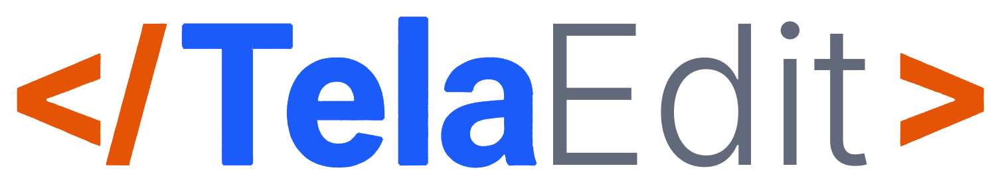
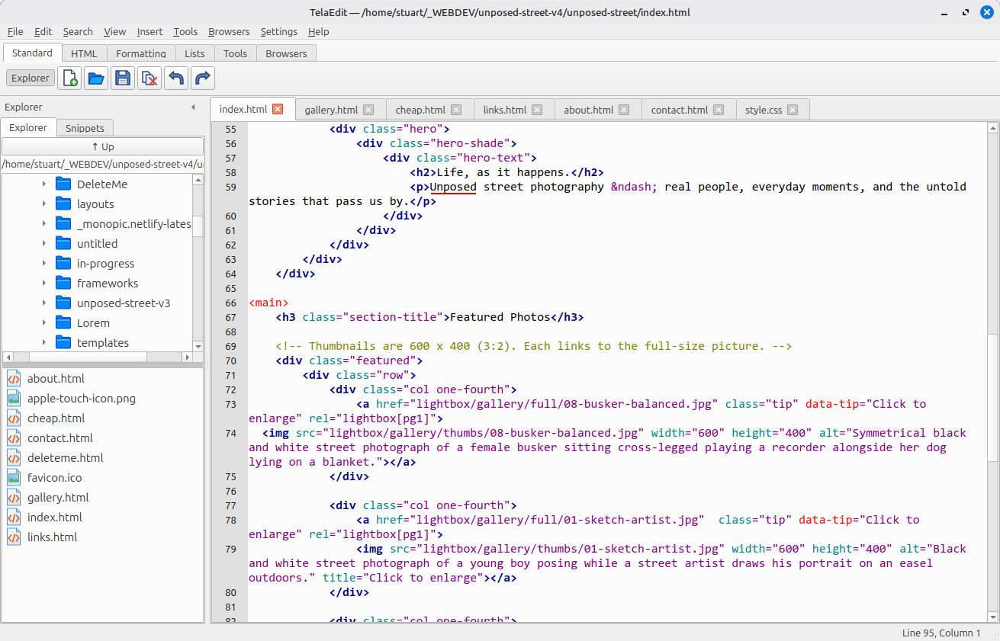
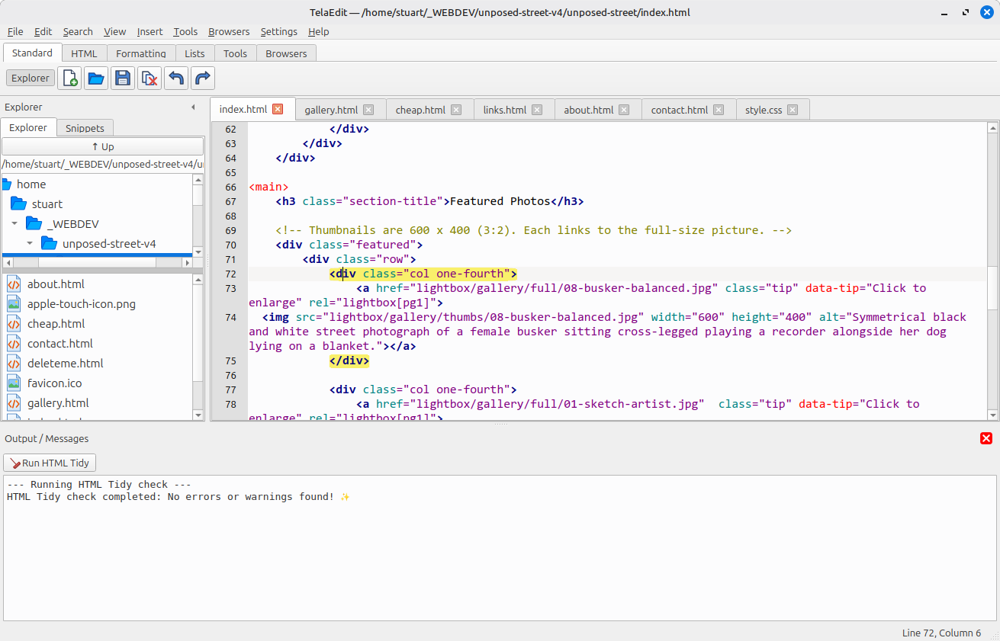
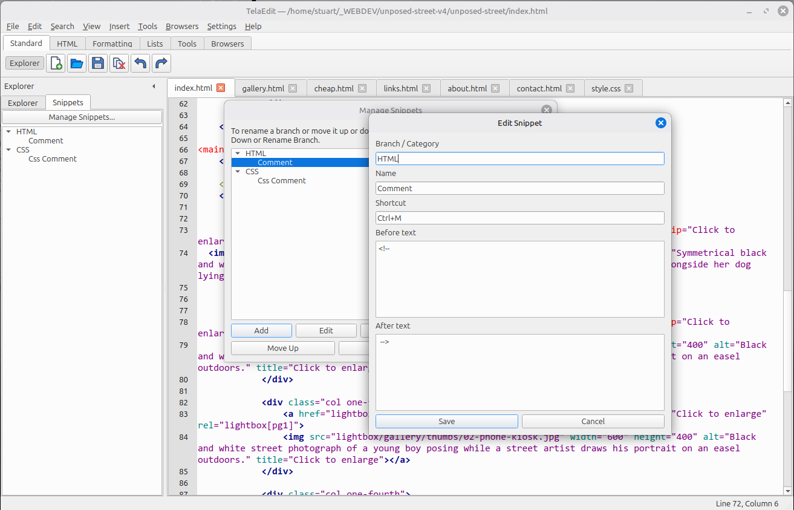

**HTML Editor for Linux**



TelaEdit is a fast, no-nonsense HTML editor for Linux, written in Python with PyQt6 and QScintilla. It is built for people who write web pages by hand and want a tidy, familiar tool: syntax colouring, tag helpers, an HTML checker, spell checking and one-click previews in all of your browsers.

Press **F1** inside TelaEdit at any time to open the built-in help.

> TelaEdit was called **SiteForge** before version 0.5. Your settings are copied across automatically the first time you start it.

---

## Features

**Editing**
- Syntax colouring for HTML, XHTML, XML, SVG, CSS and JavaScript, with the colours (and bold or normal) of every element under your control
- Tabbed editing, with your open files, cursor positions, bookmarks and window layout restored on the next start
- Tag-pair highlighting: put the cursor in a tag and its matching opening or closing tag is highlighted
- Bracket highlighting: the partner of `( )`, `[ ]` and `{ }` is highlighted, and a bracket with no partner shows in red
- Tag completion: typing `<div>` adds `</div>` and leaves the cursor in between (switch it on or off in **Settings**; tags such as `<br>` and `` are skipped)
- Find, Replace, Replace All, Find Next / Previous and Go to Line, with an option to search and replace across all open documents
- Indent and unindent for single lines and selected blocks, with your choice of spaces or tabs and indent width
- Bookmarks in the margin, word wrap, and your choice of editor font and highlight colours
- Word suggestions from the text already in your document as you type

**Inserting HTML**
- Insert menu and toolbar for paragraphs, headings, bold, italic, underline, div, lists, horizontal rule, links and images
- Link and image dialogs that work out the correct relative path to your file, and fill in the image's `width` and `height` for you
- Drag a file from the Explorer panel into the editor to insert an ``, a link, an `@import` or a `url(...)` with the right relative path
- Snippets: reusable pieces of text and code, grouped by category (you can rename and reorder the categories), that can also wrap around selected text
- Templates: start new pages from a template of your own, with a configurable default

**Checking**
- **HTML Tidy** integration: runs on the page you are editing (even unsaved), shows the report in an output panel, and **clicking a message jumps to that line and column**
- **Spell checking** for the visible text of your page: tags, attributes, scripts and styles are ignored. Right-click a word for suggestions, Ignore, or Add to dictionary. Choose the language and how misspelled words are marked
- **Document Weight**: adds up the size of a page plus its local images, stylesheets and scripts

**Previewing and tools**
- Open the current page in up to ten browsers, with shortcuts for the first three and `F12` for your default. Browsers get one of five generic icons, or any icon you choose
- Add your own programs (a graphics editor such as GIMP, for example) to the **Tools** menu and toolbar, optionally passing them the file you are editing
- Two-panel Explorer: your folders above, the files of the chosen folder below, with a divider you can drag and file-type icons. Right-click for **Open in file manager**
- A Snippets panel, and an output panel
- Toolbar icon size of 20, 24 or 32 pixels
- Customisable keyboard shortcuts for every command
- One-click **Backup Configuration** to a ZIP file

---

## Installation

### Option 1: standalone download (easiest)

1. Download `telaedit-linux-vX.Y.tar.gz` from the [Releases](../../releases) page.
2. Extract it, open a terminal in the extracted folder and run:

   ```
   ./install.sh
   ```

3. TelaEdit appears in your applications menu. To remove it later, run `./install.sh --uninstall`.

The standalone build is for 64-bit Linux and includes everything it needs, so you do not need to install Python or Qt. It was built on Linux Mint (Debian-based); it may not run on much older distributions.

If you used SiteForge before, `./install.sh` also removes the old SiteForge program and menu entry. Your settings in `~/.config/SiteForge` are never deleted.

### Option 2: run from source

You need Python 3 and these packages:

```
pip install PyQt6 PyQt6-QScintilla
```

On Debian-based systems you may prefer to do this inside a virtual environment:

```
sudo apt install python3-venv
python3 -m venv venv
./venv/bin/pip install -r requirements.txt
./venv/bin/python3 telaedit.py
```

### Optional programs

TelaEdit works without these, but two features rely on them:

| Feature | Needs | Install on Debian / Ubuntu / Mint |
|---|---|---|
| HTML Tidy | `tidy` | `sudo apt install tidy` |
| Spell checking | `aspell` or `hunspell`, with a dictionary | `sudo apt install aspell aspell-en` or `sudo apt install hunspell hunspell-en-gb` |

---

## Getting started

1. Start TelaEdit. It opens a new page from your default template, or the files you had open last time.
2. Write some HTML. Use the **Insert** menu or toolbar for common tags, and the Explorer panel to find your files.
3. Save the page, then press `F12` to see it in your default browser.
4. Run **Tools > Run HTML Tidy** to check your markup, and click any message to jump straight to the problem.
5. Press `F1` for the full help.



### Default keyboard shortcuts

| Keys | Command |
|---|---|
| `Ctrl+N` / `Ctrl+O` / `Ctrl+S` | New / Open / Save |
| `Ctrl+Shift+S` / `Ctrl+Alt+S` | Save As / Save All |
| `Ctrl+W` / `Ctrl+Q` | Close tab / Quit |
| `Ctrl+Z` / `Ctrl+Y` | Undo / Redo |
| `Ctrl+F` / `F3` / `Shift+F3` | Find and Replace / Find Next / Find Previous |
| `Ctrl+H` / `Ctrl+G` | Replace / Go to Line |
| `Ctrl+]` / `Ctrl+[` | Indent / Unindent line |
| `Ctrl+Shift+]` / `Ctrl+Shift+[` | Indent / Unindent block |
| `F12` | Open in default browser |
| `Ctrl+F2` `Ctrl+F3` `Ctrl+F4` | Open in the first, second, third browser |
| `F1` | Help |

Every shortcut can be changed in **Settings > Keyboard Shortcuts**.

---

## Configuration

TelaEdit stores all of its settings in `~/.config/TelaEdit/`:

| File or folder | Contents |
|---|---|
| `state.json` | Open files, window layout, font, colours, indentation, tag completion and spell check settings |
| `shortcuts.json` | Your keyboard shortcuts |
| `browsers.json` | Your browser list |
| `browser_icons/` | Icons you chose with **Other icon...** in Configure browsers |
| `external_tools.json` | Your external tools |
| `user_dictionary.txt` | Words you added to the spelling dictionary |
| `templates/` | Page templates |
| `snippets/` | Snippets |

Use **File > Backup Configuration...** to save all of this into a single ZIP file. To reset TelaEdit, close it and rename the `~/.config/TelaEdit` folder.

The first time TelaEdit starts, it copies everything from `~/.config/SiteForge/` (if that folder exists) into `~/.config/TelaEdit/`. The old folder is left as it was.



---

## Building the standalone program

From a folder containing the script, `icons` and `help` folders, and a virtual environment with PyInstaller installed:

```
./venv/bin/pip install pyinstaller
./build.sh
```

`build.sh` runs PyInstaller with `--onefile`, bundling the `icons` and `help` folders. To package the result as a release download with the installer script:

```
./make-release.sh 0.5
```

This creates `release/telaedit-linux-v0.5.tar.gz`.

---

## Project layout

```
telaedit.py         the application
icons/              toolbar, menu, file-type and browser icons
help/               the built-in help (help.html and its logo)
build.sh            builds the standalone program with PyInstaller
make-release.sh     packs the standalone program for download
install.sh          installer included in the download
requirements.txt    the Python packages needed to run from source
```

---

## Known limitations

- Linux only. Some default paths (such as the browser locations) assume a typical Linux layout.
- Document Weight does not count images that are referenced only from inside a CSS file.
- Spell checking only covers HTML and text files, not CSS or JavaScript.

---

## Troubleshooting

| Problem | What to try |
|---|---|
| Help (F1) does not open | Check that `help/help.html` is next to the program. The standalone build includes it. |
| No spelling underlines | Tick **Settings > Spell checking**, install `aspell` or `hunspell`, and check the language in **Settings > Spelling language** |
| Tidy reports it is not installed | `sudo apt install tidy` |
| A browser button does nothing | Check the program path in **Browsers > Configure browsers...**, and save the page first |
| Open in file manager does nothing | TelaEdit uses the standard `xdg-open` command, so check that your desktop has a default file manager |
| The menu entry is missing after installing | Log out and back in, or run `./install.sh` again |

---

## Contributing

Bug reports and suggestions are welcome. Please open an issue and include what you were doing, what you expected, and what happened, plus any message shown in the terminal.

---

## Licence

TelaEdit is released under the **GNU General Public License v3.0**, because it is built on PyQt6 and QScintilla, which are GPL-licensed. See the `LICENSE` file for the full text.

HTML Tidy, aspell and hunspell are separate programs, used if installed, and are not part of TelaEdit.

---

## Credits

TelaEdit is a hobby project, written for my own use and shared in case it is useful to others.

**Built with Claude.** I'm not a programmer. TelaEdit (known as SiteForge until version 0.5) was developed in conversation with AI assistants, mainly [Claude](https://claude.ai) from Anthropic, with earlier work done with ChatGPT. I decided what the editor should do, tested every change on my own computers, and directed the design. Claude wrote most of the code and the help file.

**Artwork**
- The TelaEdit logo grew out of the earlier SiteForge logo, which was first generated by Claude and then reworked by me.
- The application icon is my own design, based on the logo.
- The toolbar, menu and file-type icons were drawn by Claude for this project. They are original artwork and are released under the same licence as the rest of TelaEdit.
- Browser names and logos belong to their respective owners.

**Software TelaEdit relies on**
- [Qt](https://www.qt.io/) and [PyQt6](https://www.riverbankcomputing.com/software/pyqt/), the toolkit the editor is built with
- [QScintilla](https://www.riverbankcomputing.com/software/qscintilla/), the text editing component
- [HTML Tidy](https://www.html-tidy.org/), used to check pages (installed separately)
- [GNU Aspell](http://aspell.net/) or [Hunspell](https://hunspell.github.io/), used for spell checking (installed separately)
- [PyInstaller](https://pyinstaller.org/), used to build the standalone program
